# 🐕 Quadruped Robot — 12-DoF Four-Legged Locomotion Platform

**B.Tech Robotics & Automation · Project Phase 1 · Adi Shankara Institute of Engineering & Technology, Kalady (APJ Abdul Kalam Technological University) · 2025–26**

A low-cost, modular **12-DoF quadruped** built from the open-source **Nova SM3** design, adapted to our own dimensions, **3D-printed and assembled into a working prototype**, driven by an **ESP32 + PCA9685** and 12 DS3235MG servos, with **inverse-kinematics-based crawl / walk / trot gaits** designed and simulated in **Webots**.


<p align="center">
  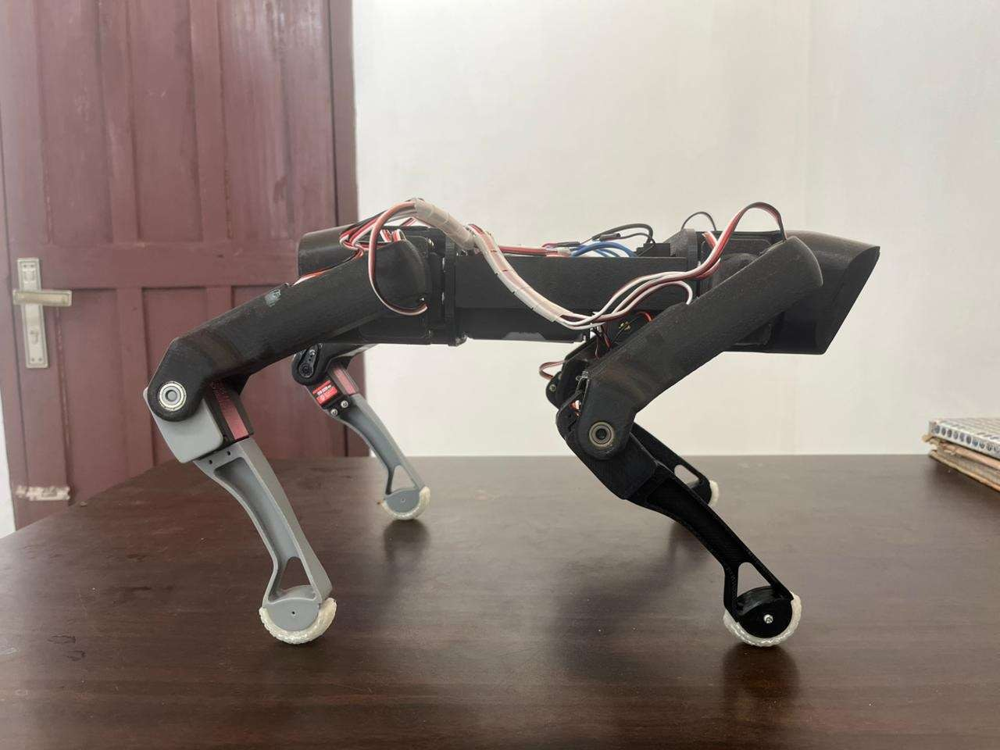
  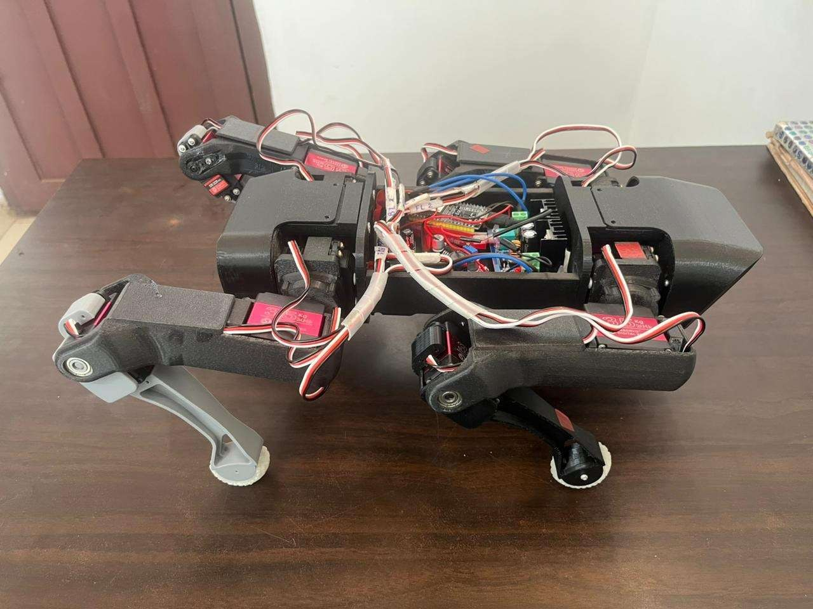
</p>
<p align="center"><em>The 3D-printed prototype in standing and sitting postures.</em></p>

## 📑 Contents
[Overview](#-overview) · [Objectives](#-objectives) · [Problem](#-problem-statement) · [Design](#-robot-design) · [Hardware](#-hardware--software) · [Architecture](#-system-architecture) · [Principle](#-working-principle) · [Gaits](#-gait-mechanism--locomotion) · [Webots](#-webots-simulation) · [Run](#-how-to-run-the-webots-simulation) · [Results](#-results--observations) · [Applications](#-applications) · [Future](#-future-scope) · [Structure](#-repository-structure) · [Team](#-team)

## 🔎 Overview
Phase 1 delivered a complete 12-DoF quadruped (3 servos per leg: hip abduction, thigh, knee). Open-source CAD files were modified to our dimensions, the parts were
3D-printed and assembled with the electronics, and the servos were calibrated (≈ ±2°). It stands and sits stably on hardware. Foot trajectories and three gaits (crawl, walk, trot) are generated from one inverse-kinematics-based
controller and were validated in Webots simulation. Gait trials on the hardware showed limited stability, so real-time gait testing on the robot is the focus of Phase 2.

## 🎯 Objectives
1. Coordinated control of all 12 servos (ESP32 → I²C → PCA9685, 50 Hz update).
2. Servo calibration and offset tuning for balanced standing and sitting.
3. Inverse kinematics and gait patterns (crawl, walk, trot) from a single controller.
4. Wireless (Wi-Fi) command interface between the ESP32 and an operator terminal.
5. Evaluate stability, synchronisation and basic locomotion in hardware and simulation.

## ❓ Problem Statement
Wheeled and tracked robots struggle on uneven terrain such as rubble, construction sites and rough outdoor ground.
Legged robots can cross such terrain but need coordinated gait generation, balance and posture control, and careful
mechanical and actuator design. This project builds a low-cost, modular platform to study these problems, as a base for
later sensing, autonomy and payload work.

## 🛠 Robot Design
The mechanical design is based on the open-source **Nova SM3 (Nova Spot Micro 3)** CAD files, modified to our own dimensions; the body and legs are 3D-printed.

<p align="center">
  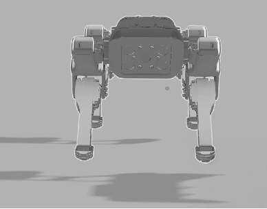
  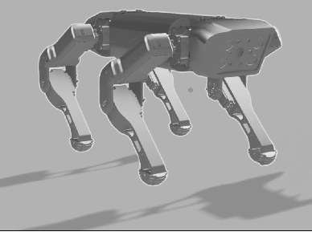
  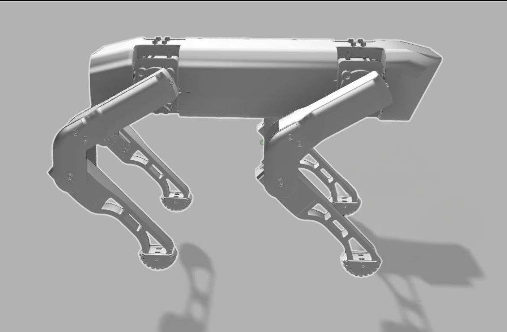
</p>

<p align="center">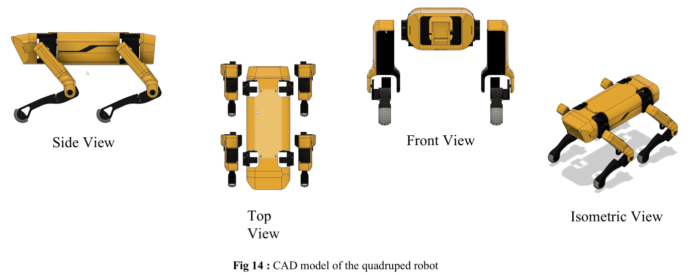</p>
<p align="center"><em>CAD model of the quadruped robot: side, top, front and isometric views.</em></p>

<p align="center">
  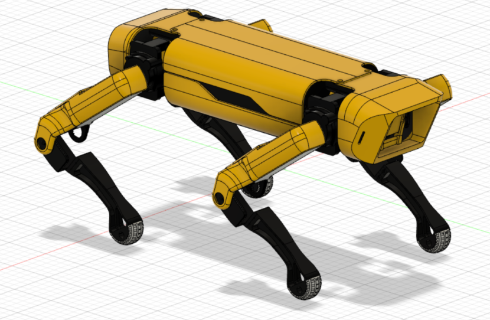
  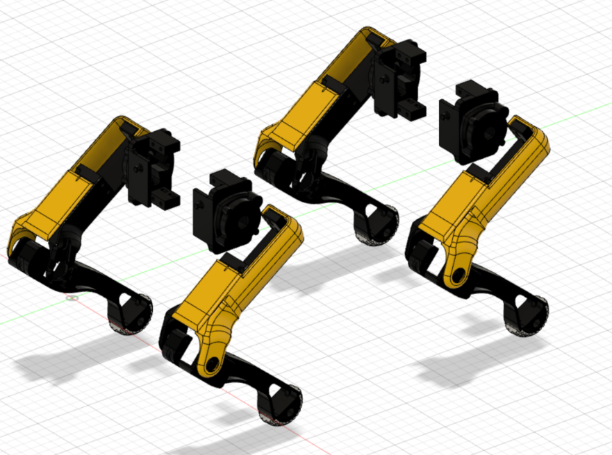
</p>
<p align="center">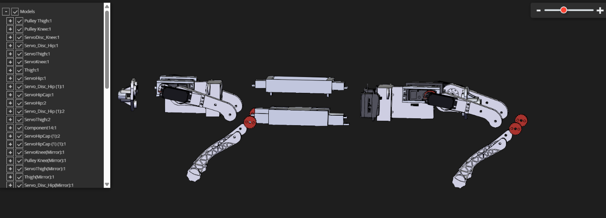</p>
<p align="center"><em>CAD views. The part browser lists components such as hip, thigh and knee servos, servo discs and pulleys.</em></p>

| Parameter (physical robot, from report) | Value |
|---|---|
| Degrees of freedom | 12 (hip abduction, thigh, knee × 4) |
| Thigh / shank length | 113.0 mm / 150.5 mm |
| Hip-to-hip body length × width | 330 mm × 140 mm |
| Standing height (hip to ground) | 200 mm |
| Leg reach (max / min) | 263.5 mm / 37.5 mm |
| Standing IK solution (hip, thigh, knee) | 0°, −48.21°, 82.26° |

<p align="center">
  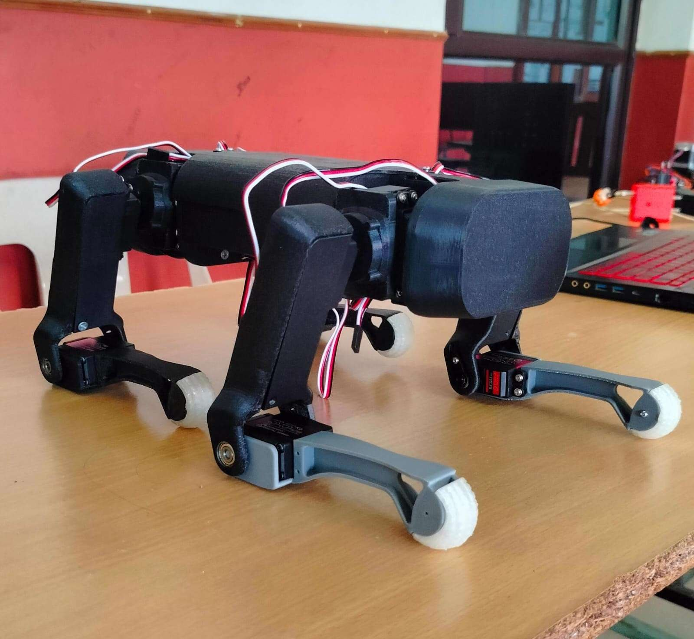
  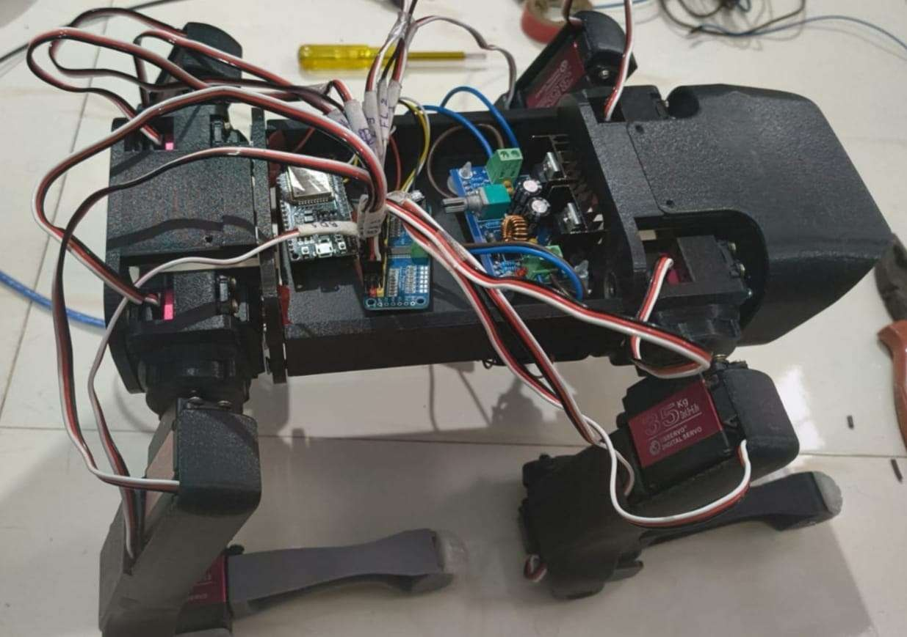
</p>
<p align="center">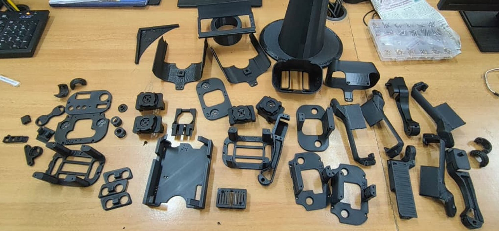</p>
<p align="center"><em>3D-printed parts (body shells, hip and leg brackets, stand) before assembly.</em></p>
<p align="center">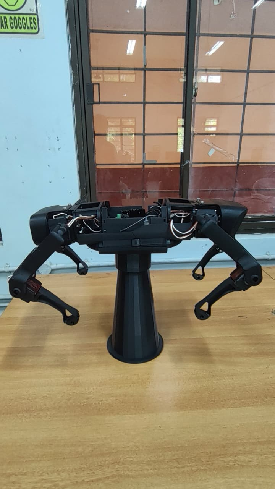</p>
<p align="center"><em>Assembled prototype on a bench stand, with the electronics fitted inside the body.</em></p>

## 🔩 Hardware & 💻 Software
| Item | Detail |
|---|---|
| Actuators | 12 × DS3235MG metal-gear digital servos: 35 kg·cm at 6 V, 0.17 s/60° at 6 V, 4.8–7.2 V, ≈ 40 × 20 × 40.5 mm |
| Controller | ESP32-WROOM-32 (dual-core 32-bit Xtensa LX6, up to 240 MHz, 520 KB SRAM, 3.3 V; I²C on GPIO21 SDA / GPIO22 SCL) |
| Servo driver | PCA9685: 16 PWM channels, 12-bit (4096 steps), I²C, 2.3–5.5 V logic, adjustable PWM frequency (40 Hz–1.6 kHz) |
| Power | 6 × 18650 Li-ion cells (3000 mAh, 3.7 V nominal; bare cells, so external protection such as a fuse or BMS is required) with rocker switch; LM2596 buck converter (logic; 4–40 V in, adjustable 1.25–37 V out, up to 3 A) and XL4016 buck converter (servos, 6–7 V; 8–40 V in, 1.25–36 V out, up to 8 A), common ground |
| Structure | 3D-printed body and legs |
| CAD | Nova SM3 open-source design, adapted to our dimensions |
| Simulation | Webots, Python (gait engine, analysis) |
| Firmware | ESP32 (C++), per the report |

**Technologies:** Python · C++ (ESP32) · Webots · Fusion 360 · I²C · PWM · inverse kinematics · 3D printing

## 🧩 System Architecture
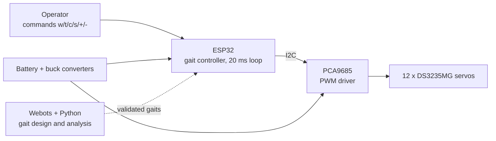
<p align="center">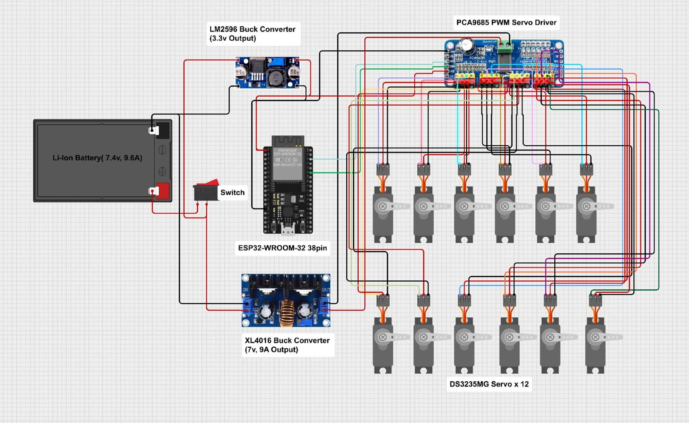</p>

## ⚙️ Working Principle
The ESP32 runs the low-level loop at a fixed 20 ms (50 Hz): parse the command (`w` walk, `t` trot, `c` crawl, `s` stand, `+`/`-` speed),
ramp the stride amplitude, compute each leg's phase and foot target, solve inverse kinematics, convert to servo angle → pulse width → PCA9685 ticks.
Heavy work (gait design, tuning, joint analysis) is done on a computer in Webots; the ESP32 runs the resulting motion deterministically.
Before floor tests, the robot is lifted, each joint's `SERVO_ZERO` and direction sign `DIR` are calibrated, then stand → crawl → walk → trot are tried.

## 💾 ESP32 Firmware (excerpt)
<p align="center">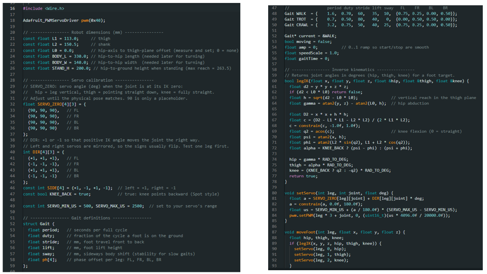</p>
<p align="center">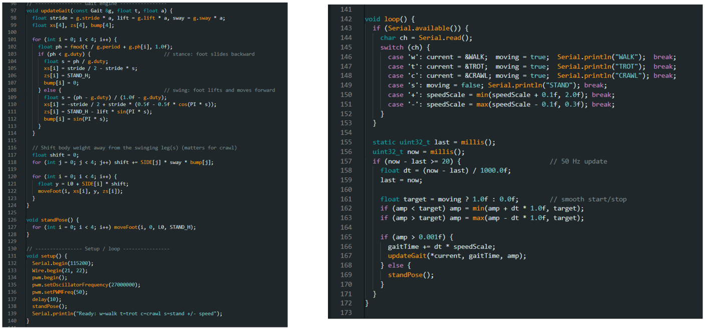</p>
<p align="center"><em>Second excerpt: gait engine (stance/swing foot targets, weight shift), setup, and the 50 Hz main loop with single-letter commands (<code>w</code> walk, <code>t</code> trot, <code>c</code> crawl, <code>s</code> stand, <code>+</code>/<code>-</code> speed) and a smooth start/stop ramp.</em></p>
<p align="center"><em>Excerpt of the ESP32 firmware (Arduino C++, Adafruit PCA9685 library): robot dimensions, per-joint calibration tables (<code>SERVO_ZERO</code>, <code>DIR</code>), the walk / trot / crawl gait table, the inverse-kinematics routine and servo output. The full source file is not yet in this repository.</em></p>

## 🦿 Gait Mechanism & Locomotion
- **Inverse kinematics:** the 3-DoF leg is split into a hip-abduction problem (y–z plane) and a two-link thigh/knee problem (law of cosines, cosine clamped to [−1, 1] to avoid NaN near the workspace limit).
- **Foot trajectory:** each foot follows a closed Cartesian curve driven by one phase variable. Stance is a straight backward slide; swing uses a cosine blend in x and a half-sine lift in z, so the foot lifts and lands with zero velocity.
- **Weight shift (sway):** lateral sway keeps the centre of mass over the support triangle (25 mm crawl, 10 mm walk, none for trot).
- **Start/stop ramp:** an amplitude variable moves smoothly between standing and gait.

| Gait (report, Table 5.4) | Period | Duty | Stride | Lift | Sway | Phase offsets FL, FR, BL, BR |
|---|---|---|---|---|---|---|
| Walk | 1.6 s | 0.70 | 60 mm | 35 mm | 10 mm | 0.75, 0.25, 0.00, 0.50 |
| Trot | 0.7 s | 0.50 | 80 mm | 40 mm | 0 mm | 0.00, 0.50, 0.50, 0.00 |
| Crawl | 3.2 s | 0.75 | 50 mm | 40 mm | 25 mm | 0.75, 0.25, 0.00, 0.50 |

<p align="center">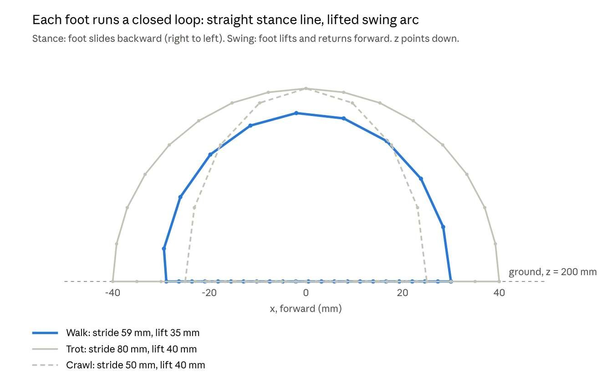</p>

## 🌍 Webots Simulation
<p align="center">
  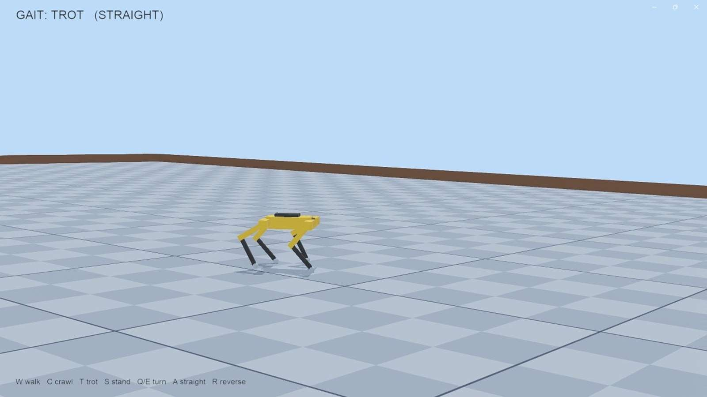
  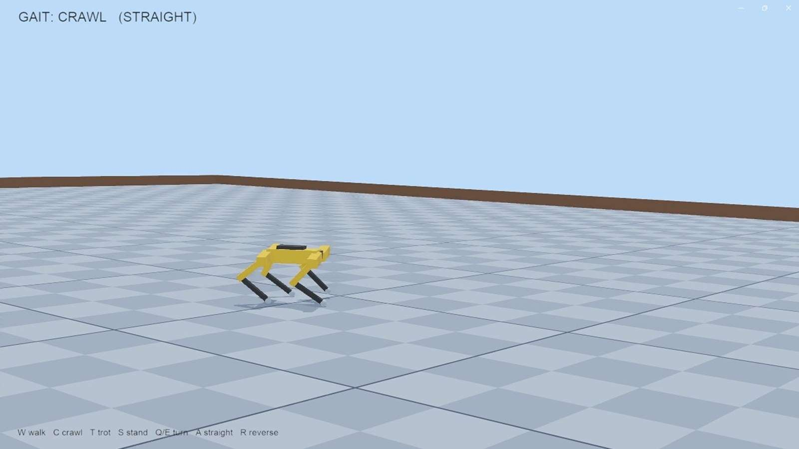
</p>

The Webots project in [`simulation/webots/`](simulation/webots) contains a 16 × 16 m checkered arena, a 12-servo Spot-Micro-style
robot defined inline, a keyboard-driven Python controller, and tools. The controller emulates the PCA9685 layer
(angle → 500–2500 µs pulse → 12-bit tick) so the same gait code can be pointed at real servos. The simulated robot has no sensors; all gaits are open-loop.

| File | Role |
|---|---|
| `controllers/spotmicro_gaits/gaits.py` | IK/FK and gait generator (no Webots import; `python3 gaits.py` self-test) |
| `controllers/spotmicro_gaits/spotmicro_gaits.py` | Webots controller: keyboard, servo-driver layer, on-screen label |
| `worlds/gait_arena.wbt` | Arena world with the robot |
| `tools/generate_world.py` | Regenerates the world and floor texture |
| `tools/check_gaits.py` | Offline gait checks (joint limits, speed, stability margin, torque) |

> **Note:** the Webots model uses Spot-Micro dimensions (body 186 × 78 mm, thigh 107.5 mm, shank 130 mm, about 1.9 kg) and its own gait table
> in `gaits.py`; these differ from the physical robot's dimensions and gait parameters listed above. See the Webots project's own
> [README](simulation/webots/README.md) for its parameters.

## ▶️ How to Run the Webots Simulation
1. Install **Webots R2023b or newer**; set *Preferences → Python command* to Python 3.
2. `File → Open World…` → `simulation/webots/worlds/gait_arena.wbt`.
3. Click in the 3D view for keyboard focus, then:

| Key | Action |
|---|---|
| `W` / `C` / `T` / `S` | Walk / Crawl / Trot / Stand |
| `Q` / `E` / `A` | Turn left / turn right / straight |
| `R` | Toggle reverse |

Offline checks (no Webots; needs `numpy`, `pillow` for the world generator):
```bash
cd simulation/webots
python3 controllers/spotmicro_gaits/gaits.py
python3 tools/check_gaits.py
```

## 📊 Results & Observations
**Hardware (Phase 1)**
- All 12 servos controlled through ESP32 + PCA9685; calibration accuracy ≈ ±2°.
- Stable standing and sitting with constant PWM values and symmetric joint angles on all four legs.
- Gait trials on the hardware showed **limited stability** (vibration under load, only partial diagonal-leg synchronisation; the robot does not walk long distances and tends to lose balance, since there is no feedback loop). Gaits therefore have not yet been demonstrated reliably on the real robot; real-time gait testing is planned for Phase 2.

<p align="center">
  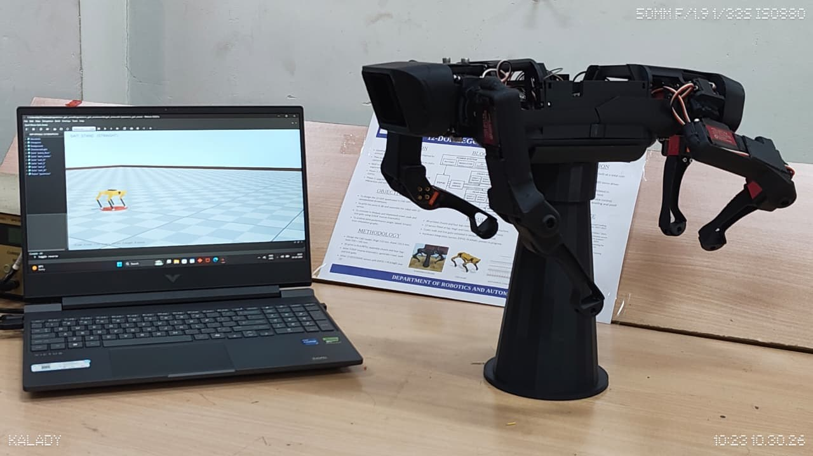
  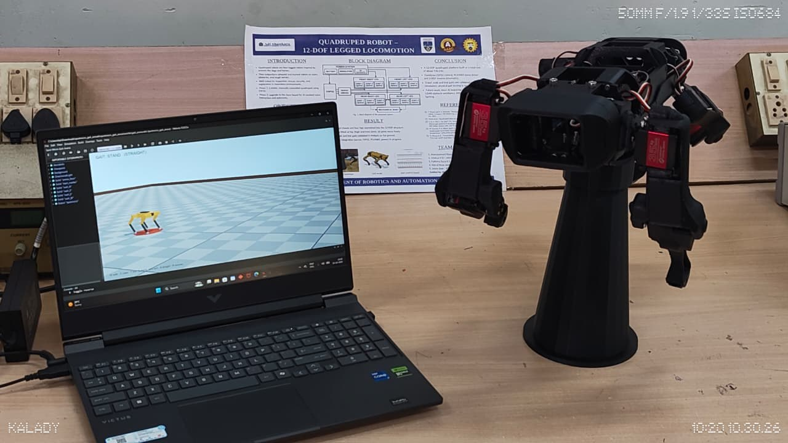
</p>
<p align="center">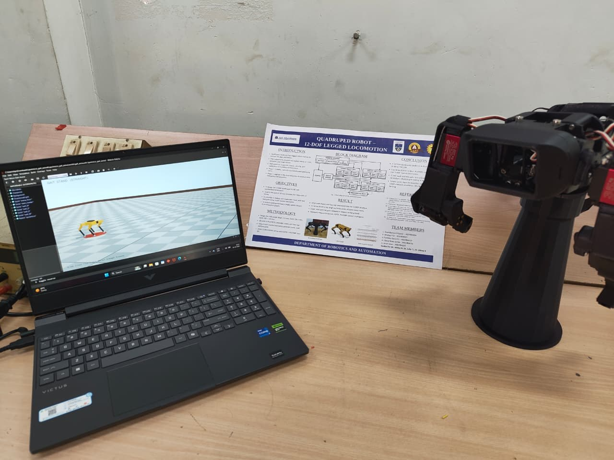</p>
<p align="center"><em>Hardware and simulation: the printed prototype (mounted on a bench stand) next to the Webots simulation in its stand state, with the project poster.</em></p>

**Simulation videos (Webots, keyboard-driven gaits)** — click a thumbnail to play the video.

<p align="center">
  <a href="videos/webots_walk_gait.mp4">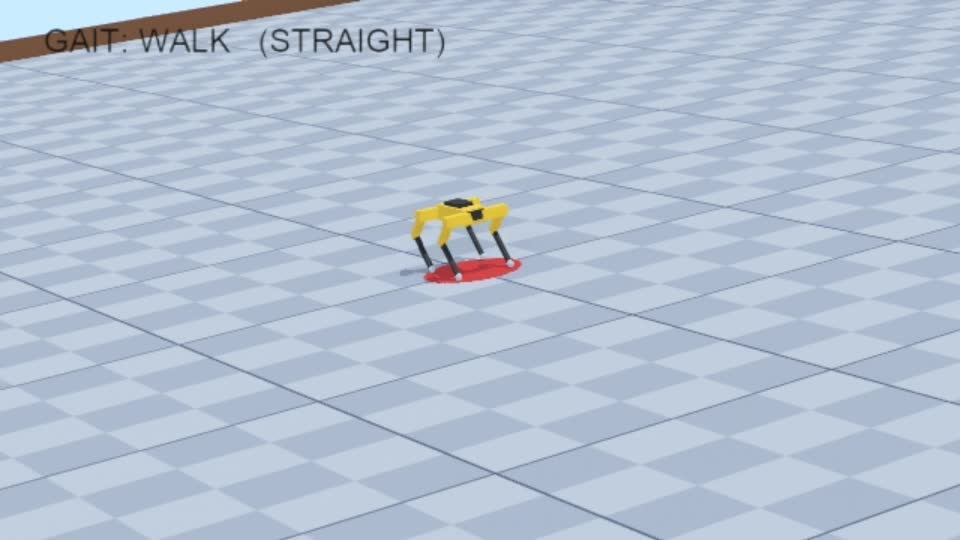</a>
  <a href="videos/webots_trot_gait.mp4">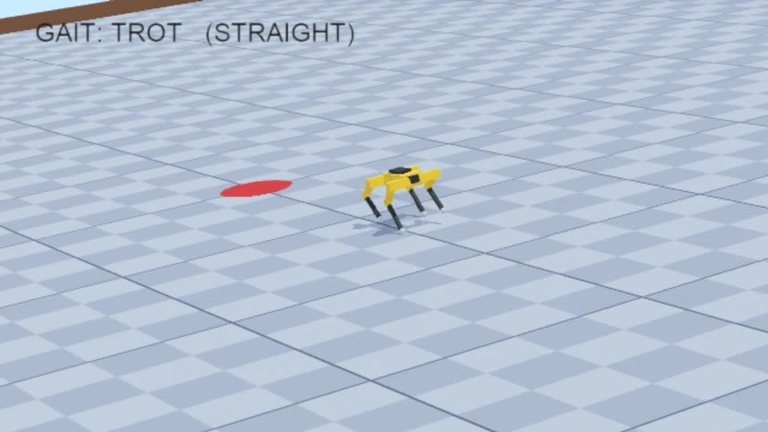</a>
  <a href="videos/webots_crawl_gait.mp4">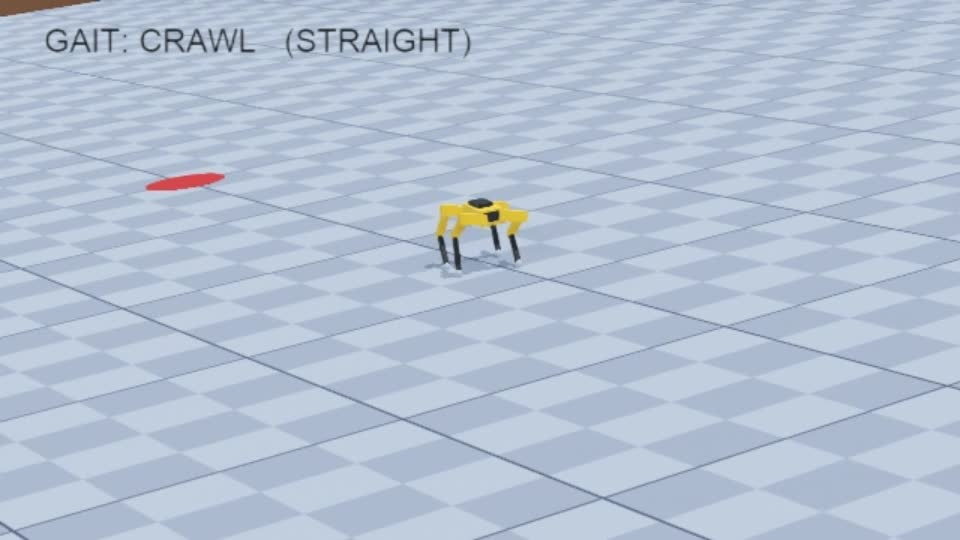</a>
</p>
<p align="center"><em>Walk · Trot · Crawl (flat arena, straight line)</em></p>

**Simulation (Webots, logged runs from the report; plots made with Python/matplotlib)**
- Joint trajectories are periodic, bounded and symmetric for trot, crawl and walk; PWM targets stay within ≈ 237–472 ticks.
- Crawl shows the largest shoulder (lateral weight-shift) motion; trot keeps shoulders fixed.
- Thigh joints show the largest PWM variation in every gait, so they are the ones to watch on hardware.

| Webots run (approx., from plots) | Trot | Crawl | Walk |
|---|---|---|---|
| Gait cycle | ≈ 0.8 s | ≈ 2.0 s | ≈ 2.0 s |
| Shoulder range | ≈ 0 | ±0.25 rad | ±0.25 rad |
| Leg PWM (ticks) | 383–452 | 362–472 | 350–458 |

<p align="center">
  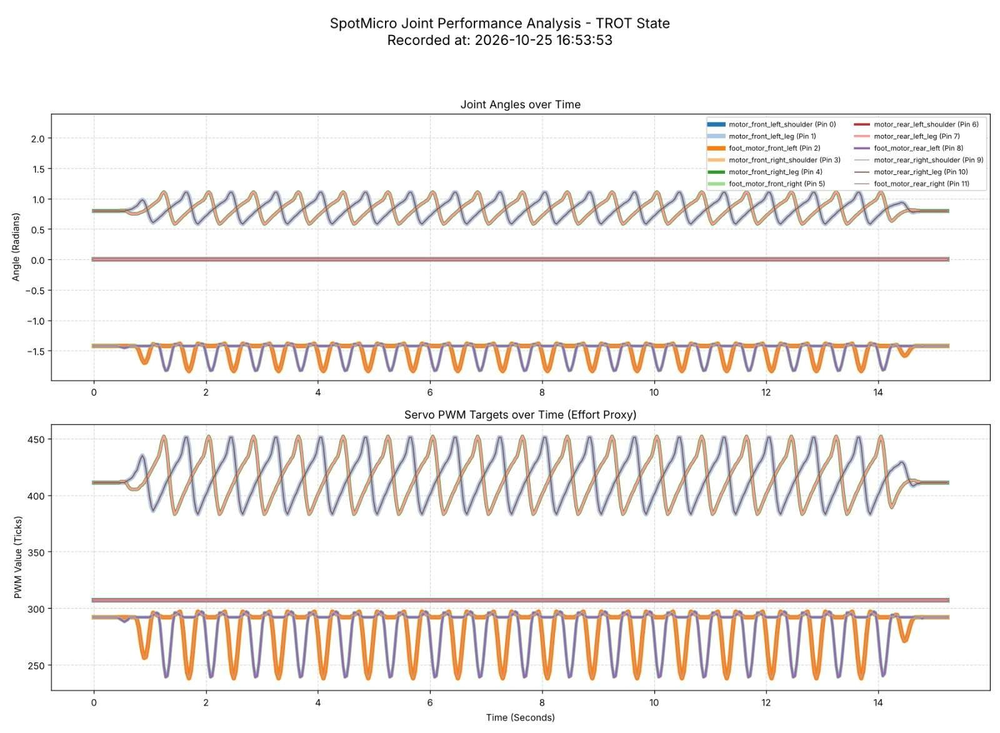
  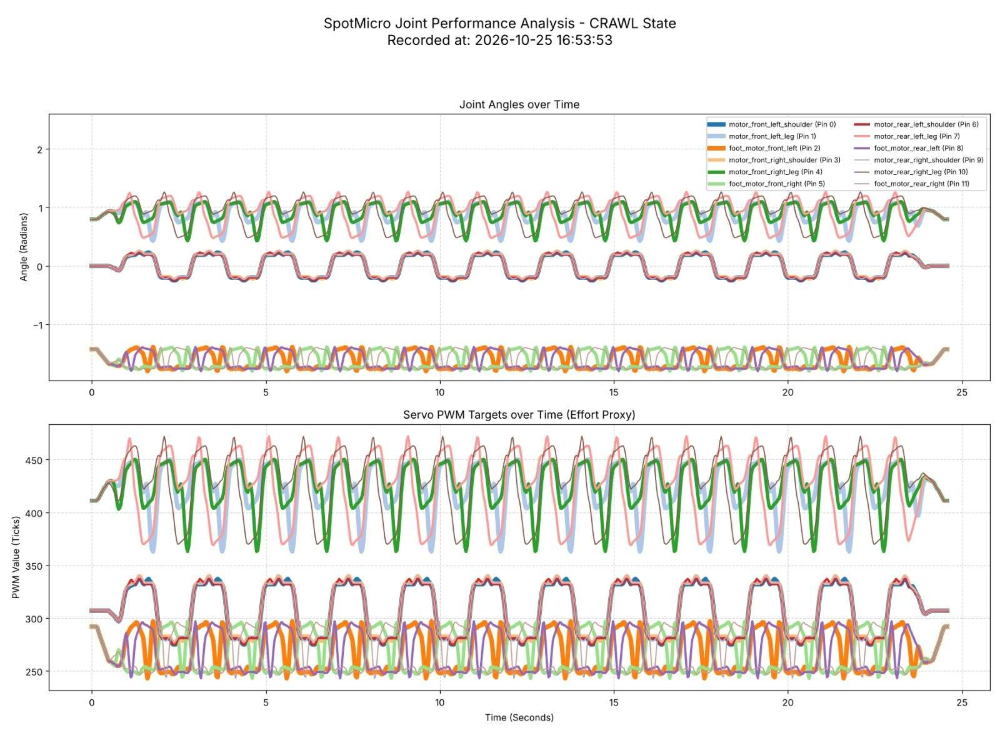
  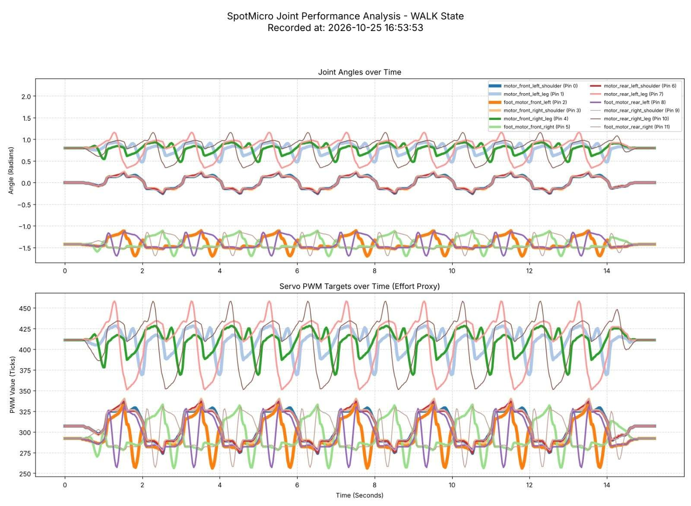
</p>

The simulation is an ideal model (no backlash, voltage drop or heating, no IMU), so it does not reproduce the hardware's vibration and partial synchronisation; it serves as a benchmark.

**Challenges solved:** servo tolerance (per-joint calibration), mirrored servos (`DIR` sign), voltage-drop resets (separate buck converters), stiff motion (cosine-blended trajectories), centre-of-mass during leg lift (sway), IK NaN near limits (clamping).

## 🏭 Applications
Education and research in legged locomotion · prototype platform for inspection and exploration · base for rough-terrain robots where wheels struggle (as motivated in the report).

## 🚀 Future Scope (Phase 2 plan from the report)
<p align="center">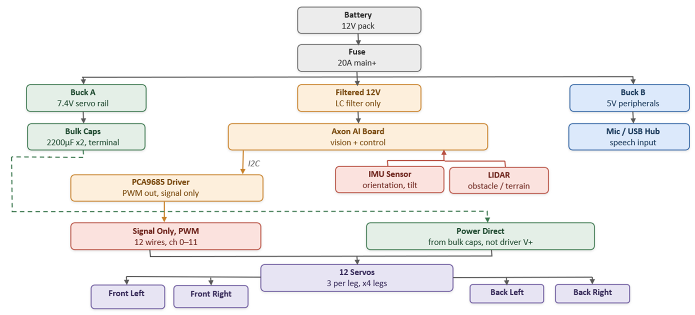</p>
<p align="center"><em>Planned Phase 2 architecture: an Axon AI board for vision and control, with IMU, LiDAR and a microphone, driving the 12 servos through the PCA9685 over I²C.</em></p>

The planned design uses a 12 V battery with a 20 A fuse and two buck converters: a 7.4 V servo rail fed through bulk capacitors straight to the servos (not through the driver's V+), and a 5 V rail for peripherals (microphone / USB hub for speech input). The PCA9685 carries PWM signals only.

- Closed-loop balance with an MPU6050 IMU
- Smoother velocity profile at stance/swing transitions
- Turning through stride scaling
- Stability-based sway from centre of mass and support polygon
- Real-time gait testing on the hardware with voice-command control, using an Axon AI board <!-- TODO: add what the board is and its role -->
- Polished wireless interface, ultrasonic obstacle sensing, autonomous mode
- Mechanical refinement, verified in Webots first

Suggested software improvements are listed separately in [IMPROVEMENTS.md](IMPROVEMENTS.md); the original code is unchanged.

## 📁 Repository Structure
```
Quadruped-Robot/
├── simulation/webots/   # Webots project (worlds, controllers, tools), original files
├── hardware/cad/        # CAD source / STEP / STL files (to be added)
├── images/              # robot photos, CAD views, Webots screenshots, result plots
├── videos/              # Webots gait videos (walk, trot, crawl)
├── docs/                # Project Phase 1 report (PDF)
├── diagrams/            # block and wiring diagrams
├── IMPROVEMENTS.md
└── README.md
```

## 👥 Team
Group project, Dept. of Robotics and Automation, Adi Shankara Institute of Engineering & Technology, Kalady. Guide: Dr. Athira M.

Anandanunni Vijayan · Drishya V D · Fathima Sana K S · Glynal Rose James · Joson Jose

**My contribution:** I worked across all areas of the project, mainly the Webots simulation of the crawl, walk and trot gaits; I also assembled the prototype and arranged its components.

## 🙏 Credits
- Mechanical design: based on **Nova SM3 (Nova Spot Micro 3)**, an open-source Spot-Micro-style quadruped ([Instructables page](https://instructables.com/Nova-Spot-Micro-a-Spot-Mini-Clone)). That page credits the original 3D design to Deok-yeon Kim (Thingiverse). Please see the Nova SM3 pages for the author and licence terms. <!-- TODO: add exact author and licence after checking the source page -->
- The Webots robot is Spot-Micro style (the report describes it as "SpotMicro type").
